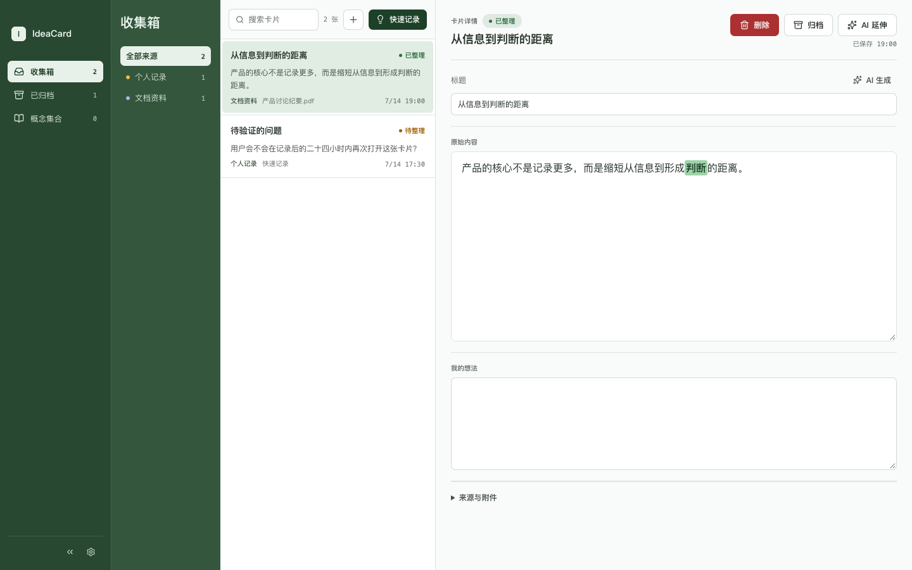

# IdeaCard

把临时想法、剪藏资料和自己的思考，放进同一个收集箱。

IdeaCard 是面向 macOS 的个人卡片工具。通过菜单栏、全局快捷键、剪贴板、截图 OCR 和文件导入收集内容，再用卡片整理、概念注释与 AI 对话帮助理解和延伸想法。

目前处于早期开发阶段，界面以中文为主。正式桌面工程位于 `desktop/`，`prototype/` 保留最初的交互原型。已提供未公证的 Mac 内测安装包，可直接下载安装。

## 下载 Mac 内测版

**[下载 IdeaCard v0.1.0-beta.1 安装包（约 14 MB）](https://github.com/niedawu-sketch/IdeaCard/releases/download/v0.1.0-beta.1/IdeaCard_0.1.0-beta.1_aarch64.dmg)** · [安装说明](https://github.com/niedawu-sketch/IdeaCard/releases/download/v0.1.0-beta.1/2026-10-12-installation-guide.txt) · [版本详情与校验文件](https://github.com/niedawu-sketch/IdeaCard/releases/tag/v0.1.0-beta.1)

适用于 **M 系列芯片 Mac（Apple Silicon），macOS 14 及以上**；本机启动验证在 macOS 26.5.2 完成。打开下载的 `.dmg`，将 `IdeaCard.app` 拖入“应用程序”；已有旧版时先从菜单栏退出应用。

这是未经过 Apple 公证的内测版，首次打开可能出现安全提示，请按安装说明操作。AI 功能需要自行配置 API Key；不配置 AI 也可使用基础记录与整理功能。



*截图使用合成演示资料，来自桌面界面测试。*

## 当前能力

- **快速捕获**：快速记录、剪贴板文字与图片、区域截图和本地 OCR，以及常见文档、图片和音视频文件导入。
- **卡片整理**：统一收集箱、搜索、来源筛选、正文和“我的想法”编辑、正文贴图、归档与恢复。
- **概念注释**：选中文字后由 AI 解释，保存为原文注释与概念集合，追溯来源卡片。
- **AI 延伸**：每张卡片拥有独立对话，支持流式回答、Markdown 展示、复制、重新生成及供应商支持的联网查询。
- **模型与提示词**：接入 OpenAI、DeepSeek、OpenAI 兼容接口和 Anthropic Claude；在设置中配置模型、概念解释和标题生成提示词。
- **标题生成**：首次创建时尝试生成一次标题；用户也可手动重新生成，自动保存不会触发生成。

当前不包含云同步、多人协作、自动概念抽取或自主研究代理。多卡片分析是早期原型探索，尚未作为正式桌面端的完整流程交付。滚动截图入口暂时停用。

## 从源码运行

桌面端当前支持 **Apple Silicon Mac（arm64），macOS 14 及以上**。原生组件构建脚本暂不支持 Intel Mac、Windows 或 Linux。

准备环境：

- Node.js 22.12+ 的 22.x 或 Node.js 24.x，npm 10+。
- Rust 工具链 1.97.0，版本固定在 `desktop/rust-toolchain.toml`。
- Xcode Command Line Tools；Swift 工具链需支持 Swift 6.2 或更高版本。

克隆仓库后，在项目根目录运行：

```bash
cd desktop
npm ci
npm run tauri dev
```

Rust 依赖在首次编译时下载。启动命令会构建 Swift 原生组件和前端，再打开桌面应用。如果已运行安装版 IdeaCard，先退出它，避免两个进程共用数据和快捷键。

只查看桌面界面：

```bash
cd desktop
npm ci
npm run dev
```

前端服务地址为 `http://localhost:1420`，由 Tauri 开发窗口加载。直接在普通浏览器打开时没有 Tauri 桥接，卡片读取等操作会报错；需要可交互的浏览器演示时，运行 `prototype/`。

详细的构建、验证、数据目录与原生输入说明见 [桌面端开发说明](desktop/README.md)。早期原型的运行方法见 [原型说明](prototype/README.md)。

## 快捷键

| 操作 | 快捷键 |
| --- | --- |
| 快速记录 | `Control + Option + Space` |
| 捕获剪贴板 | `Control + Option + V` |
| 截图并识别 | `Control + 1` |

截图 OCR 使用 macOS Vision 在本机执行；截图需要系统屏幕录制权限。受支持的普通文本字段使用原生 AppKit 控件，可配合系统中文输入法和外部语音输入工具；富文本编辑器与设置页字段的兼容性仍有限。

## 数据与 AI

卡片、附件、概念和对话历史保存在本机。API Key 存储在 macOS 钥匙串，不写入数据库或前端持久化状态。当前没有云同步。

使用 AI 延伸、概念解释或标题生成时，对应文本和上下文会发送到你在设置中选择的模型服务。模型调用需要自行配置 API Key，并遵循对应服务的计费与数据政策。未配置模型时仍可收集和整理卡片。

## 项目结构

```text
desktop/     Tauri 2 + React + TypeScript + Rust 桌面工程，含 Swift 原生组件
prototype/   早期浏览器交互原型
docs/        产品规格、实施计划与决策记录
scripts/     项目辅助脚本
PRODUCT.md   产品定位和当前功能边界
DESIGN.md    设计 token 与组件规范
AGENTS.md    工程协作规则
```

## 参与贡献

欢迎提交可复现的问题和范围明确的改进。开发前请阅读 [贡献说明](CONTRIBUTING.md)、[项目规则](AGENTS.md) 与 [产品上下文](PRODUCT.md)；界面改动还应遵循 [设计规范](DESIGN.md)。

## 许可证

IdeaCard 使用 [MIT 许可证](LICENSE)，版权归 `niedawu` 所有。第三方依赖遵循各自的许可证。
